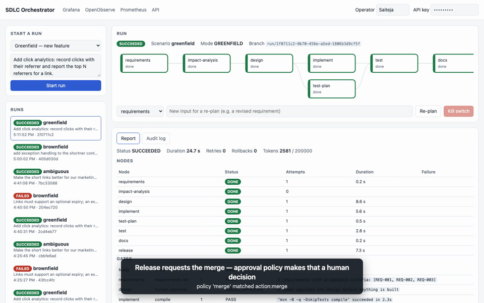

# Agentic SDLC Orchestrator

> **Repo:** https://github.com/saiteja2024/Agentic-Url-Shortner

## Walkthrough video (4 min 48 s)

[](docs/demo/walkthrough.webm)

**[▶ Watch the walkthrough](docs/demo/walkthrough.webm)** (WebM, 1440×900, captioned, no audio). It shows the
contract-first shortener (including the SSRF guardrails), the greenfield, brownfield and ambiguous runs
with approvals, retries, rollback, escalation, clarifications and a minimal re-plan, the kill switch,
the full run trace in OpenObserve, the three Grafana dashboards and the Prometheus alert rules. Every
step is real; the video was captured with a scripted browser session against the running stack.

A governed, agentic software-delivery pipeline that turns a requirement into a reviewable
engineering outcome. Eight agents (requirements → impact analysis → design → implement ‖ test
plan → test → docs → release) run as a **dependency graph** with entry/exit gates, parallel
branches and a join barrier. Humans approve high-impact steps, answer clarifying questions and
own the final merge. Failures are **retried with feedback**, then **rolled back and escalated**.
Every state change lands in an **append-only audit log**, and the run is traced and measured
end to end.

The system it builds and governs is a **URL shortener**, written contract-first in this repo
(`shortener/`), plus a small seed project (`scenarios/seed/linkkit`) that the agents change in
each run.

## Run it (3 commands)

```bash
cp .env.example .env && docker compose up -d --wait
```

```bash
./mvnw -q -DskipTests package
```

```bash
java -jar orchestrator/target/orchestrator-0.1.0-SNAPSHOT.jar & java -jar shortener/target/shortener-0.1.0-SNAPSHOT.jar &
```

Then run the three scenarios end to end and save their evidence to `scenarios/`:

```bash
python3 scripts/run_scenarios.py
```

Needs Docker, Java 21, Maven 3.9+ on the PATH (the gates build the seed project with `mvn`),
git and Python 3. In `.env`, set `OTLP_AUTH_HEADER` as described there to ship traces and logs.

| What | URL |
|---|---|
| Operator console (live DAG, approvals, report, audit log) | http://localhost:8080 |
| Orchestrator API (Swagger UI on the hand-written spec) | http://localhost:8080/swagger-ui/index.html |
| URL shortener API (Swagger UI) | http://localhost:8081/swagger-ui/index.html |
| Grafana (dashboards: Orchestrator Overview, Governance, Service Health) | http://localhost:3000 |
| OpenObserve (traces and logs) | http://localhost:5080 |
| Prometheus (metrics, alert rules) | http://localhost:9090 |

Logins and the orchestrator API key come from `.env`.

## The three scenarios

| Scenario | What it shows | Evidence |
|---|---|---|
| **Greenfield**: click analytics | Requirements with IDs, design approval, `implement` ‖ `test-plan` in parallel, real compile/test/coverage gates, merge approval by policy | [summary](scenarios/greenfield/summary.md) |
| **Brownfield**: link expiry | Impact analysis verified against the code, a regression caught by `tests-pass`, a retry with feedback that recovers, then a test agent that exhausts 3 attempts, is rolled back and escalated, and a human rejects it | [summary](scenarios/brownfield/summary.md) |
| **Ambiguous**: "make links better for marketing" | Clarifying questions pause the run; one answer is recorded and two become explicit assumptions; a later re-plan re-runs only what changed (design output unchanged, so nothing below it re-runs) | [summary](scenarios/ambiguous/summary.md) |

Each scenario folder holds `audit-log.json` (the append-only event log), `report.json` and `run.json`.

## Repository map

| Path | Contents |
|---|---|
| `specs/` | **Source of truth**: requirements with IDs (SHORT-, ORCH-, OBS-), OpenAPI 3.1 contracts, `pipeline.yaml` |
| `orchestrator/` | DAG engine, agents, gates, governance, API, operator console |
| `shortener/` | Contract-first URL shortener (Base62, aliases, expiry, SSRF guardrails, analytics) |
| `common/` | Content hashing and logging keys shared by both services |
| `observability/` | Prometheus config and alert rules, Grafana provisioning and dashboards |
| `scenarios/` | Seed project for runs, and the saved scenario evidence |
| `scripts/` | `traceability.py` (requirement → test matrix), `run_scenarios.py` |
| `docs/` | [Architecture](docs/architecture.md), [testing, risks and limitations](docs/testing-and-risks.md), [runbook](docs/runbook.md), [traceability](docs/traceability.md), [recording script](docs/recording-script.md) |
| `DECISIONS.md` | ADR-001 … ADR-009 |

## Quality gates

`./mvnw verify` runs Checkstyle, OpenAPI code generation, about 210 tests (unit, MockMvc with
OpenAPI contract validation, Testcontainers Postgres, end-to-end scenarios), Spotless and a
JaCoCo gate (≥ 80 % line and ≥ 70 % branch per module). CI also lints the specs, checks that
every requirement has a passing test (`scripts/traceability.py`), and scans dependencies (OSV,
plus PR dependency review).
