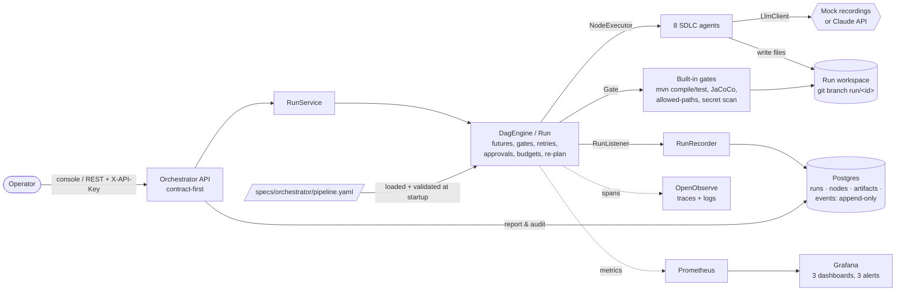
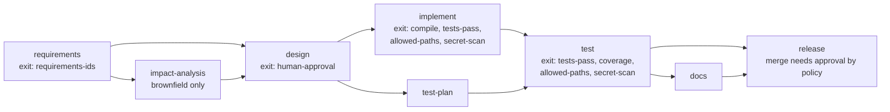
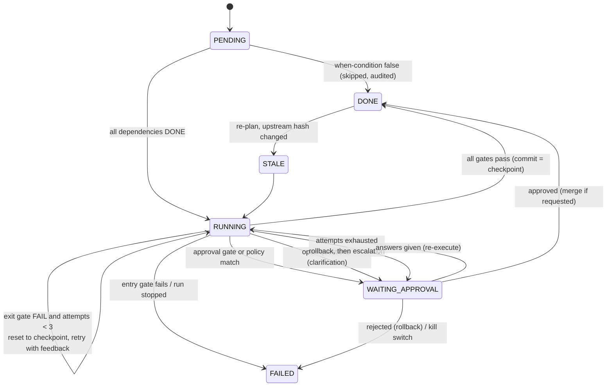

# Architecture

The orchestrator runs a requirement through a governed SDLC pipeline. Agents do the work;
the engine decides what may run, checks every output and stops for a human wherever impact is
high. Everything is recorded in an audit log nobody can rewrite.

## Components

| Component | Responsibility | Key code |
|---|---|---|
| Pipeline loader | Strict YAML → stages, gates, approval policy; validates ids, edges, gates; Kahn cycle detection | `pipeline/PipelineLoader`, `PipelineValidator`, `dag/DagPlan` |
| DAG engine | One `CompletableFuture` per node; join barrier through `allOf(dependencies)`; failure stops only the downstream path | `dag/DagEngine`, `dag/Run` |
| Governance | Retries with feedback, rollback, escalation, policy approvals, clarifications, kill switch, token and time budgets, re-plan | `dag/Run` |
| Agents | Prompt from upstream artifacts, answers and the last failure; reply → files, artifact, questions, actions | `agent/LlmAgent`, `AgentCatalog` |
| LLM | `MockLlmClient` (deterministic recordings, the default) or `ClaudeLlmClient` (official SDK) | `agent/*LlmClient` |
| Workspace | Copy of the target project, git branch per run, commit per node, reset and merge | `workspace/GitWorkspace` |
| Gates | `command`, `coverage`, `allowed-paths`, `secret-scan`, `requirements`, `approval` | `gate/BuiltInGates` |
| Audit | Every event persisted in order; report rebuilt only from the log | `persistence/RunRecorder`, `service/RunQueries` |
| API and UI | Contract-first REST (`specs/orchestrator/openapi.yaml`), API-key filter, operator console | `web/*`, `static/index.html` |

## The pipeline (from `specs/orchestrator/pipeline.yaml`)

`implement` and `test-plan` run in parallel; `test` waits for both (the join barrier).
Approval policy, independent of stage: changes to schemas, `pom.xml` dependencies,
security files or a `merge` action always pause for a human.

## Control flow of one node

Each attempt runs entry gates, then the agent, then the non-approval exit gates (machine
checks first), then approval gates and policy rules. Only when everything is green is the work
committed and a human asked to approve, so a human never reviews output that a machine would
have rejected.

## Lineage and re-plan

Every artifact stores its SHA-256 and the hashes of its direct parents' artifacts
(`orchestrator.artifacts.parent_hashes`). A re-plan re-executes the chosen node with new input
and compares its output hashes: if they changed, its dependents are marked `STALE` and re-run,
recursively; if not, nothing below it runs again. The ambiguous scenario shows this: revised
requirements re-run `design`, and its output is unchanged, so implementation, tests and release
are kept.

## Data model

| Table | Holds |
|---|---|
| `orchestrator.runs` | One row per run: scenario, mode, request, branch, status, stop reason |
| `orchestrator.nodes` | Latest status, attempt and failure reason per node |
| `orchestrator.artifacts` | Content (JSONB), `content_hash`, `parent_hashes` |
| `orchestrator.events` | The audit log. A trigger rejects UPDATE, DELETE and TRUNCATE even for the owner; the `orchestrator_app` role only has SELECT and INSERT |
| `shortener.urls`, `shortener.clicks` | The shortener's data, with a unique code constraint as the collision arbiter |

## Observability

- **Traces**: one trace per run: `orchestrator.run` → `orchestrator.node` → `orchestrator.gate` /
  `orchestrator.approval`, tagged with node, attempt, outcome and decision. HTTP requests are
  traced too, and responses carry `X-Trace-Id`.
- **Logs**: JSON lines with `traceId`, `spanId`, `runId` and `nodeId`, shipped to OpenObserve over OTLP.
- **Metrics**: run outcomes, run and node durations (histograms), retries, rollbacks, gate
  failures, approval waits, recovery time (MTTR), tokens and active runs, plus HTTP and JVM
  metrics for both services.
- **Dashboards and alerts**: Orchestrator Overview, Governance and Service Health; alerts on
  success rate < 80 %, more than 2 rollbacks in 15 min, and p95 > 500 ms.

## Decisions

All decisions with context and consequences are in [`DECISIONS.md`](../DECISIONS.md):

| ADR | Decision |
|---|---|
| 001 | Maven multi-module monorepo (common, shortener, orchestrator) |
| 002 | Infrastructure in Docker Compose, apps on the host, healthchecks everywhere |
| 003 | Build gates: Checkstyle, Spotless, JaCoCo per module |
| 004 | Dependency security on Boot 3.5: version overrides plus expiring exceptions |
| 005 | Spec-driven, contract-first (requirements with IDs, generated interfaces, traceability) |
| 006 | CI on GitHub Actions with SHA-pinned actions |
| 007 | Shortener: JdbcClient, database as collision arbiter, browser-style SSRF parsing |
| 008 | DAG engine: futures as scheduler, database-enforced append-only audit |
| 009 | Agents, governance and API: mock-first LLM, git branch per run, governance in the engine |
